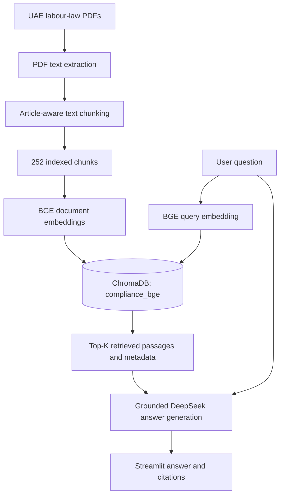

# UAE Labour Law RAG Assistant

**A document-grounded question-answering prototype for UAE labour law**, built with Python, Streamlit, ChromaDB, BGE embeddings, and DeepSeek.

The application retrieves relevant passages from a small collection of UAE labour-law documents and asks an LLM to answer from those passages, with document and article references. It is an educational/portfolio project, **not a legal-advice service**.

## Highlights

- Article-aware PDF processing and chunking, preserving document/article metadata.
- Local semantic search with **ChromaDB** and **`BAAI/bge-base-en-v1.5`**.
- Grounded answer generation through **DeepSeek (`deepseek-chat`)**.
- A **Streamlit** interface displaying responses and cited sources.
- A fixed **20-question evaluation set** and a three-model embedding benchmark.
- Separate experimental collections, allowing comparisons without overwriting the baseline MiniLM index.

## Architecture



### Corpus

The prototype processes three PDF files representing four logical sources:

| Source | Notes |
| --- | --- |
| Federal Decree-Law No. 33 of 2021 | General employment relations |
| Cabinet Resolution No. 92 of 2022 | Included within the supplied Federal Decree-Law No. 33 PDF and treated as a separate logical source |
| Federal Decree-Law No. 9 of 2022 | Domestic workers |
| Cabinet Decision No. 106 of 2022 | Executive regulations concerning domestic workers |

The current extraction/chunking workflow produces **252 chunks**. Chunking uses article boundaries where possible, with recursive splitting for longer sections. Each chunk retains a source document and article reference.

> **Document caveats:** The PDFs are **not distributed** in this repository. Supply appropriately obtained copies yourself, and check their provenance and legal currency. Some supplied English texts carry translation caveats. Additionally, the source PDF for Federal Decree-Law No. 9 of 2022 repeats an “Article 17” label after Article 26; the chunking workflow normalizes that later occurrence to Article 27 for indexing. This is an indexing correction, not a claim that the PDF itself prints “Article 27.”

## Tech stack

| Layer | Technology |
| --- | --- |
| Interface | Streamlit |
| Language | Python |
| PDF extraction | pypdf |
| Chunking | Article-aware processing + LangChain text splitters |
| Embeddings | Sentence Transformers (MiniLM, MPNet, BGE benchmarked) |
| Vector storage | ChromaDB (local persistent index) |
| Generation | DeepSeek via the OpenAI-compatible Python client |
| Evaluation | Fixed JSON question set + Python scripts |

## Embedding model benchmark

The same 252 chunks and **15 answerable questions** were used to compare retrieval ranking. Five additional questions were marked out of scope and excluded from retrieval-hit metrics.

| Model | Hit@1 | Hit@5 | Hit@10 | MRR@10 |
| --- | ---: | ---: | ---: | ---: |
| `all-MiniLM-L6-v2` | 80.0% | 86.7% | 86.7% | 0.833 |
| `all-mpnet-base-v2` | 86.7% | 93.3% | 100.0% | 0.907 |
| **`BAAI/bge-base-en-v1.5`** | **93.3%** | **100.0%** | **100.0%** | **0.967** |

**Why BGE?** The baseline embedding model struggled with some rephrasings of resignation and probation questions. BGE retrieved the expected articles at rank #1 for both of those cases in this evaluation, without changing the original chunk set or adding hybrid search.

The BGE retriever uses normalized embeddings, a cosine-distance ChromaDB collection, and the query instruction:

```text
Represent this sentence for searching relevant passages:
```

These are results from a **small project-specific benchmark**, not evidence of general or production-level reliability. Raw embedding distances are not comparable across differently configured indexes.

## End-to-end evaluation

Using BGE with top-10 retrieval:

| Check | Result |
| --- | ---: |
| Retrieval Hit@10 on answerable questions | **15/15 (100%)** |
| Expected article citation present | **15/15 (100%)** |
| Out-of-scope fallback responses | **5/5 with the revised prefix-based fallback check** |

The initial strict-exact-match fallback metric recorded **4/5**, because one otherwise appropriate fallback included an additional explanatory paragraph. The revised check accepts the standard fallback sentence at the beginning of an uncited answer. This is a **format/pattern check**, not a comprehensive test that the response contains no unsupported claims.

**Important limitations:** Answer correctness and citation faithfulness still require manual review against the source text. The evaluation set is small, and this prototype does not establish up-to-date legal coverage or production-ready abstention behavior.

## Getting started (Windows / PowerShell)

### 1. Clone and install

```powershell
git clone https://github.com/lostincalibasas/uae-labour-law-rag.git
cd uae-labour-law-rag
python -m venv venv
.\venv\Scripts\Activate.ps1
pip install -r requirements.txt
```

The first run may download Sentence Transformers model weights from Hugging Face. A CPU is sufficient for this small corpus, though indexing may take some time.

### 2. Configure your DeepSeek API key

Create a local `.env` file in the repository root:

```dotenv
DEEPSEEK_API_KEY=your_deepseek_api_key_here
```

**Never commit this file or your real credentials.** `.env` is excluded through `.gitignore`.

### 3. Supply the source PDFs

Create `data/raw_docs/` and place the three input PDFs there, using these filenames:

```text
data/raw_docs/
├── Cabinet Decision No. 106 of 2022.pdf
├── Federal Decree-Law No. 33 of 2021.pdf
└── Federal Decree-Law No. 9 of 2022.pdf
```

These PDFs and the derived text/index data are not committed to GitHub.

### 4. Extract and chunk the documents

Run commands from the repository root:

```powershell
python extract_text.py
python chunk_text.py
python check_chunks.py
```

This creates `data/extracted_text.json` and `data/chunks.json`.

### 5. Build local vector collections

First, build the original MiniLM baseline collection:

```powershell
python build_vector_store_bge.py
```

Then build the experimental MPNet and BGE collections:

```powershell
python compare_embedding_models.py
```

`compare_embedding_models.py` requires the baseline `compliance_docs` collection and constructs separate `compliance_mpnet` and **`compliance_bge`** collections. It also writes `embedding_comparison_results.json` locally. The BGE retriever intentionally fails if `compliance_bge` does not exist.

> **Code compatibility check:** The current index builder is the original MiniLM pipeline, while `retrieve_bge.py` reads the BGE index. Before running on a fresh clone, ensure the committed `build_vector_store.py` executes successfully; the BGE comparison script depends on that baseline index. Likewise, confirm that `generate_answer.py` imports `retrieve_chunks` from `retrieve_bge` in the version you are running. These integration points should be consolidated in a future cleanup.

### 6. Launch the app

```powershell
streamlit run app.py
```

Example questions:

- How much notice must an employee give when resigning?
- I am on probation and want to join another company in the UAE. How much notice should I give?
- If I leave the UAE during probation, what notice is required?

## Evaluation commands

```powershell
# Fast smoke test (includes DeepSeek generation)
python evaluate.py --limit 3

# Full 20-question evaluation
python evaluate.py

# Test retrieval only, without DeepSeek API calls
python evaluate.py --retrieval-only

# Rebuild candidate indexes and compare embedding models
python compare_embedding_models.py
```

The evaluation writes its detailed output to `evaluation_results.json` (ignored by Git). Its citation score tests the **presence of the expected citation**, not whether every factual statement is faithfully supported.

## Repository layout

```text
├── app.py                         # Streamlit interface
├── extract_text.py                # PDF text extraction
├── chunk_text.py                  # Article-aware chunking
├── check_chunks.py                # Corpus/chunk coverage checks
├── build_vector_store.py          # Original MiniLM vector index
├── retrieve.py                    # Original retriever
├── retrieve_bge.py                # Selected BGE retriever
├── generate_answer.py             # DeepSeek grounded generation
├── compare_embedding_models.py    # MiniLM / MPNet / BGE benchmark
├── evaluate.py                    # Retrieval and generation evaluation
├── rag_evaluation_20_questions.json
├── requirements.txt
└── data/                           # PDFs, generated chunks and indexes are local
```

Additional backup/experimental scripts may be present from earlier development iterations.

## Next improvements

- **Manually verify legal answers** and cited clauses against primary documents.
- **Test generalization** on more questions, paraphrases, and adversarial/out-of-scope prompts.
- **Calibrate abstention/relevance handling** for BGE cosine distances; do not reuse a MiniLM distance threshold blindly.
- **Experiment with hybrid retrieval** (BM25 + vector search, fused using Reciprocal Rank Fusion) and benchmark it against the BGE-only baseline.
- **Consolidate configuration and setup** so a fresh clone can build the selected index through a single documented command.

## Disclaimer

This is a learning and portfolio project. It may contain extraction errors, translation differences, incomplete legal coverage, or generated inaccuracies. It does not provide legal advice. Always verify applicable legal requirements using current authoritative sources or a qualified professional.
