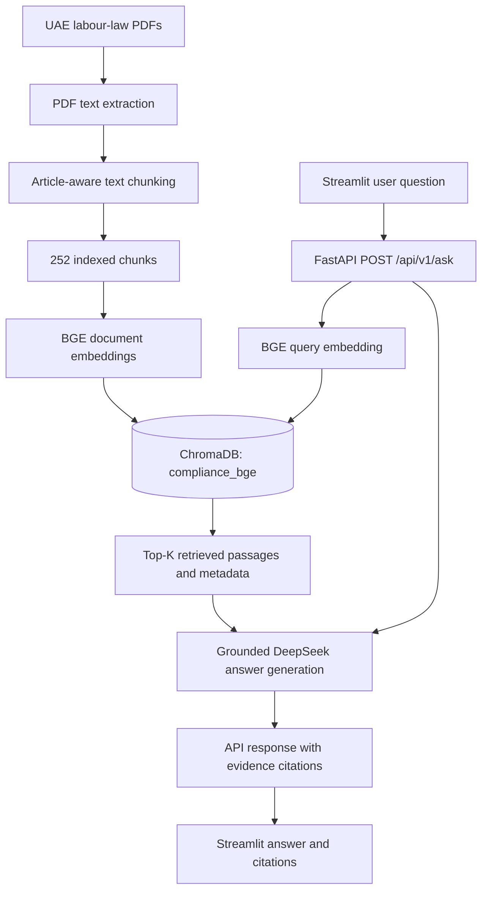

# UAE Labour Law RAG Assistant

**A document-grounded question-answering prototype for UAE labour law**, built with Python, FastAPI, Streamlit, ChromaDB, BGE embeddings, and DeepSeek.

The application retrieves relevant passages from a small collection of UAE labour-law documents and asks an LLM to answer from those passages, with document and article references. It is an educational/portfolio project, **not a legal-advice service**.

## Highlights

- Article-aware PDF processing and chunking, preserving document/article metadata.
- Local semantic search with **ChromaDB** and **`BAAI/bge-base-en-v1.5`**.
- Grounded answer generation through **DeepSeek (`deepseek-chat`)**.
- Query-local evidence IDs with citations resolved from retrieved passage metadata.
- A **Streamlit** interface displaying responses, verified references, and supporting excerpts.
- A fixed **20-question evaluation set** and a three-model embedding benchmark.
- Isolated benchmark databases, allowing comparisons without opening or changing the active indexes.

## Architecture



### Corpus

The prototype processes three PDF files representing four logical sources:

| Source | Notes |
| --- | --- |
| Federal Decree-Law No. 33 of 2021 | General employment relations |
| Cabinet Resolution No. 92 of 2022 | Included within the supplied Federal Decree-Law No. 33 PDF and treated as a separate logical source |
| Federal Decree-Law No. 9 of 2022 | Domestic workers |
| Cabinet Decision No. 106 of 2022 | Executive regulations concerning domestic workers |

The current extraction/chunking workflow produces **252 chunks**. Chunking uses article boundaries where possible, with recursive splitting for longer sections. Each chunk retains a source document and article reference.

> **Document caveats:** The PDFs are **not distributed** in this repository. Supply appropriately obtained copies yourself, and check their provenance and legal currency. Some supplied English texts carry translation caveats. Additionally, the source PDF for Federal Decree-Law No. 9 of 2022 repeats an “Article 17” label after Article 26; the chunking workflow normalizes that later occurrence to Article 27 for indexing. This is an indexing correction, not a claim that the PDF itself prints “Article 27.”

## Tech stack

| Layer | Technology |
| --- | --- |
| Interface | Streamlit |
| Backend | FastAPI + Uvicorn, shared Pydantic HTTP contracts |
| Language | Python |
| PDF extraction | pypdf |
| Chunking | Article-aware processing + LangChain text splitters |
| Embeddings | Sentence Transformers (MiniLM, MPNet, BGE benchmarked) |
| Vector storage | ChromaDB (local persistent index) |
| Generation | DeepSeek via the OpenAI-compatible Python client |
| Evaluation | Fixed JSON question set + Python scripts |

## Embedding model benchmark

The same 252 chunks and **15 answerable questions** were used to compare retrieval ranking. Five additional questions were marked out of scope and excluded from retrieval-hit metrics.

| Model | Hit@1 | Hit@5 | Hit@10 | MRR@10 |
| --- | ---: | ---: | ---: | ---: |
| `all-MiniLM-L6-v2` | 80.0% | 86.7% | 86.7% | 0.833 |
| `all-mpnet-base-v2` | 86.7% | 93.3% | 100.0% | 0.907 |
| **`BAAI/bge-base-en-v1.5`** | **93.3%** | **100.0%** | **100.0%** | **0.967** |

**Why BGE?** The baseline embedding model struggled with some rephrasings of resignation and probation questions. BGE retrieved the expected articles at rank #1 for both of those cases in this evaluation, without changing the original chunk set or adding hybrid search.

The BGE retriever uses normalized embeddings, a cosine-distance ChromaDB collection, and the query instruction:

```text
Represent this sentence for searching relevant passages:
```

These are results from a **small project-specific benchmark**, not evidence of general or production-level reliability. Raw embedding distances are not comparable across differently configured indexes.

## End-to-end evaluation

The results below are historical, from the original law/article string matcher. Evidence-ID validation now replaces that matcher; these files have not been overwritten or rescored. Run a new evaluation with a new `--output` path before comparing Phase 2 results.

Using BGE with top-10 retrieval:

| Check | Result |
| --- | ---: |
| Retrieval Hit@10 on answerable questions | **15/15 (100%)** |
| Expected article citation present | **15/15 (100%)** |
| Out-of-scope fallback responses | **5/5 with the revised prefix-based fallback check** |

The initial strict-exact-match fallback metric recorded **4/5**, because one otherwise appropriate fallback included an additional explanatory paragraph. The revised check accepts the standard fallback sentence at the beginning of an uncited answer. This is a **format/pattern check**, not a comprehensive test that the response contains no unsupported claims.

**Important limitations:** Answer correctness and citation faithfulness still require manual review against the source text. The evaluation set is small, and this prototype does not establish up-to-date legal coverage or production-ready abstention behavior.

## Getting started (Windows / PowerShell)

### 1. Clone and install

```powershell
git clone https://github.com/lostincalibasas/uae-labour-law-rag.git
cd uae-labour-law-rag
python -m venv venv
.\venv\Scripts\Activate.ps1
pip install -r requirements.txt
```

The first run may download Sentence Transformers model weights from Hugging Face. A CPU is sufficient for this small corpus, though indexing may take some time.

### 2. Configure your DeepSeek API key

Create a local `.env` file in the repository root:

```dotenv
DEEPSEEK_API_KEY=your_deepseek_api_key_here
```

**Never commit this file or your real credentials.** `.env` is excluded through `.gitignore`.

### 3. Supply the source PDFs

Create `data/raw_docs/` and place the three input PDFs there, using these filenames:

```text
data/raw_docs/
├── Cabinet Decision No. 106 of 2022.pdf
├── Federal Decree-Law No. 33 of 2021.pdf
└── Federal Decree-Law No. 9 of 2022.pdf
```

These PDFs and the derived text/index data are not committed to GitHub.

### 4. Extract and chunk the documents

Run commands from the repository root:

```powershell
python extract_text.py
python chunk_text.py
python check_chunks.py
```

This creates `data/extracted_text.json` and `data/chunks.json`.

### 5. Build the BGE index used by the app

On a fresh setup, build the selected BGE collection directly:

```powershell
python build_vector_store_bge.py
```

This creates `compliance_bge` using normalized BGE embeddings and cosine distance. If the collection already exists, the command leaves it unchanged. `--rebuild` deliberately replaces it; use that option only for an intentional rebuild after backing up the database.

The backend reuses `generate_answer.py` and its BGE retriever. Streamlit calls the backend over HTTP and does not import retrieval or generation. A MiniLM index and an embedding comparison run are **not required** to launch it. `build_vector_store.py` remains the legacy MiniLM builder and replaces its own collection when run. Existing installations should skip extraction and index building above.

Optional: compare all three models in a fresh benchmark database:

```powershell
python compare_embedding_models.py --output runs/embedding-comparison-01.json
```

The comparison never opens `data/chroma_db`. It builds MiniLM, MPNet, and BGE under a unique `data/benchmarks/` directory, or a new directory supplied with `--db-path`. Existing directories and paths overlapping the active database are refused. Collections use `benchmark_*` names and are never deleted or reused.

MiniLM is rebuilt from the same chunks with its original unnormalized embeddings and L2 distance; MPNet and BGE retain normalized embeddings and cosine distance. This costs an additional MiniLM embedding pass and may differ from historical scores if the old baseline was stale. Benchmark databases are retained for inspection, including after failed runs. They do not populate the app's BGE index.

### 6. Launch the app

From the repository root, activate the virtual environment in each terminal.
Close any process using the original index. Start the API in terminal one:

```powershell
python -B -m backend --port 8000
```

This Windows launcher reuses Phase 3.5 write-denying locks, copies the complete
index into a new temporary directory, verifies file hashes, and starts one
Uvicorn worker with the Chroma path guard. Source locks remain held until that
worker stops. No embeddings are rebuilt. The copy and shutdown integrity report
are retained under the printed temporary workspace. The launcher refuses active
writers, unsafe paths, unsupported locking platforms, or a changed copy.

The backend binds only to `127.0.0.1`. Keep the parent terminal open; stop with
Ctrl+C. Do not enable Uvicorn reload or multiple workers, which would bypass the
guard initialization. Plain `uvicorn backend.main:app` exposes liveness/docs but
intentionally returns unavailable for readiness and questions without the snapshot
guard. Never set a backend index path to the original directory.

Start Streamlit in terminal two:

```powershell
$env:RAG_API_BASE_URL = "http://127.0.0.1:8000"
streamlit run app.py
```

`RAG_API_BASE_URL` is read from the frontend process environment (default above),
not from `.env`. The backend loads `DEEPSEEK_API_KEY` from the environment or root
`.env` through the existing generation helper. Do not put keys in URLs.
`RAG_INDEX_PATH` and `RAG_TEST_INDEX_ROOT` are set by the isolated launcher and
must not be overridden. It also enables Hugging Face offline mode: BGE weights
must already be cached. Installing a fresh environment does not install weights.

The Streamlit HTTP client uses a 5-second connection timeout and 120-second
read/write timeout, with no automatic retries, redirects, or environment proxies.
A frontend timeout does not cancel work already running on the backend. The
existing DeepSeek timeout and zero-retry policy remain unchanged.

Example questions:

- How much notice must an employee give when resigning?
- I am on probation and want to join another company in the UAE. How much notice should I give?
- If I leave the UAE during probation, what notice is required?

### HTTP API (Phase 6)

| Endpoint | Response |
| --- | --- |
| `GET /health/live` | HTTP 200, `{"status":"alive"}`; no embeddings, index clients, or DeepSeek initialization |
| `GET /health/ready` | HTTP 200 `ready` or 503 `unavailable`, `scope: "local_configuration"`, safe `error` or null |
| `POST /api/v1/ask` | HTTP 200 for `ok` or `insufficient_evidence`; HTTP 503 for `operational_error`; HTTP 422 for invalid input |

Readiness checks the isolated-path guard, dependency availability, copied database
file readability and local API-key validation. It does not load BGE, open a Chroma
client, query a collection, authenticate with DeepSeek, or send a paid request.
It is a local preflight, **not** proof of upstream connectivity, available weights,
collection completeness or index integrity. Ask requests handle those failures
through the existing safe error catalog. Swagger UI is at
`http://127.0.0.1:8000/docs`; submitting an Ask request there invokes DeepSeek.

Request fields are `question` (strict nonblank string, at most 4,000 characters)
and optional `top_k` (strict integer 1–50, default 10). Extra fields are rejected;
callers cannot supply evidence or override citation validation.

```json
{"question":"How much notice must an employee give when resigning?","top_k":10}
```

The response uses exactly the structure in **Evidence-bound citation responses**
below, including `sources`, exact citation excerpts, `citation_validation`,
`claim_support` and safe error objects. Citation identity still does not establish
legal correctness or semantic claim support. HTTP validation errors omit submitted
values. Operational messages come only from the safe message catalog.

Modules: `backend/main.py` creates the ASGI app; `routes.py` defines endpoints;
`schemas.py` supplies shared contracts; `service.py` delegates to the existing
pipeline. `backend_client.py` is the frontend's HTTP adapter. Calls are serialized
inside this single-process prototype to protect lazy retriever initialization;
health endpoints stay independent. Experimental regime selection remains disabled.
There is no authentication, public deployment, Docker, reranking or hybrid search
in this phase. Keep this development server on loopback.

### Offline backend and regression tests

```powershell
python -B -m unittest discover -s tests -p test_backend.py -v
python -B -m unittest discover -s tests -v
python -B -m pip check
```

Tests use mocked generation, in-process HTTP transports and temporary index
fixtures. They cover Streamlit → HTTP → FastAPI → pipeline integration without
paid API calls or opening the protected original index. Readiness intentionally
cannot prove live generation works; a live smoke test is a separate approved step.

## Evaluation commands

Use the controlled 74-question evaluator described below. It opens only a byte-verified, write-locked snapshot copy. The Phase 6 backend launcher also uses snapshot isolation, but direct calls to older generation/retrieval helpers are not an isolation workflow. The historical `evaluate.py` helper refuses retrieval outside a guarded snapshot worker. Its old saved 20-question scores are historical metadata/citation-presence measurements, not answer correctness.

All evaluation outputs use exclusive creation. Choose a new output filename for each run. The embedding comparison script still builds its own fresh isolated database; it is not part of Phase 4 and must not be run as an offline answer-quality check.

## Evidence-bound citation responses

Each retrieved passage receives a query-local ID (`E1`, `E2`, ...). DeepSeek receives JSON evidence with its ID, source document, article (or null), filename, and passage text. It is instructed to cite IDs immediately after factual legal claims. The resolver accepts only IDs from that query and derives citation metadata and excerpts directly from retrieval.

`generate_answer(query, top_k=10)` still returns `answer` and a deduplicated `sources` list of document/article labels. It also returns:

```json
{
  "status": "ok",
  "error": null,
  "answer": "A claim using the supplied evidence [E1].",
  "sources": ["Federal Decree-Law No. 33 of 2021 — Article 9"],
  "citations": [{
    "evidence_id": "E1",
    "source_document": "Federal Decree-Law No. 33 of 2021",
    "article": "Article 9",
    "filename": "Federal Decree-Law No. 33 of 2021.pdf",
    "excerpt": "The exact retrieved passage appears here."
  }],
  "citation_validation": {
    "status": "valid",
    "invalid_ids": [],
    "invalid_markers": []
  },
  "claim_support": "not_evaluated"
}
```

The example illustrates the response shape, not a legal answer. IDs are not stable across questions. Multiple passages from one article retain separate IDs/excerpts while the compatibility `sources` list deduplicates their labels.

Accepted syntax includes `[E1]`, `(E1)`, `[E1, E2]`, `[E1; E2]`, adjacent citations, lowercase IDs, and whitespace. Bare IDs, ranges, malformed markers, and unknown IDs are rejected. Law/article names alone are never verified citations.

An answer with any invalid reference or no evidence citations is replaced with the standard fallback and empty `sources`/`citations`. Empty usable evidence skips generation. A model response beginning with the fallback is normalized to that exact sentence. Validation statuses are `valid`, `no_evidence`, `insufficient_evidence`, `missing_citations`, or `invalid_citations`.

**Reference validation is not semantic verification.** A valid ID proves that a referenced passage was supplied, not that it supports the claim or that every claim has a citation. Streamlit displays the exact excerpts and explains this limitation. The separate answer judge/manual review remains responsible for assessing factual support; a hallucinated claim with a real ID is not automatically detected by the citation resolver.

## Operational resilience

Model loading, ChromaDB access, `.env` loading, and API client creation happen at request time. Importing the app does not require credentials, a reachable API, or an available model/index. BGE and the database client are initialized lazily for reuse, preserving the previous resource lifecycle; no answer cache is added.

Every generation response now includes a top-level `status` and `error`:

| Status | Meaning | UI behavior |
| --- | --- | --- |
| `ok` | Complete answer with known evidence references; semantic support remains unverified | Answer and referenced excerpts |
| `insufficient_evidence` | No usable evidence, model abstention, or missing/invalid citations | Standard evidence fallback |
| `operational_error` | Configuration, index, embedding, API, or response-format failure | Actionable error message; no legal answer |

Operational failures return `answer: ""`, empty `sources`/`citations`, `citation_validation.status: "not_evaluated"`, and an `error` object with `code`, `message`, and `retryable`. `retryable` is advisory; no automatic retry occurs. Existing `answer`/`sources` callers still receive those keys, but should check `status` to distinguish outages from legal abstention. Evaluations record operational errors separately and do not give them fallback credit or send them to the semantic answer judge.

Set `DEEPSEEK_API_KEY` in the project `.env` file or environment. Blank keys, common placeholders, whitespace, and non-printable/non-ASCII values are rejected locally; authentication and permissions are checked by DeepSeek. The API endpoint and model remain `https://api.deepseek.com` and `deepseek-chat`. Each request uses a **30-second SDK timeout** and **zero SDK retries**. This is an HTTP operation timeout, not an overall deadline covering model loading and retrieval. API clients are closed after each request.

Only a single assistant response with `finish_reason: "stop"` and nonempty text can reach evidence validation. Empty/malformed responses, tool calls, refusals, unknown finish reasons, and answers cut off by the token limit are withheld as operational failures. A truncated answer containing valid evidence IDs is still rejected.

Retrieval checks for an existing `chroma.sqlite3` before opening storage, uses `get_collection`, and validates migrations instead of applying them. Missing/empty collections are operational failures; empty collections never issue an `n_results=0` query. No index is created, rebuilt, or repaired automatically. **Migration validation is not read-only storage:** opening/querying/closing a persistent Chroma client can change its physical files. Use the isolation command below for verification. A schema mismatch requires a compatible environment or deliberate maintenance outside the request path. BGE model, query prefix, normalization, ranking, and top-K behavior remain unchanged.

The `compliance_rag` Python logger emits JSON warning events with only `event`, `stage`, `code`, and `retryable`. Application logs omit exception text, credentials, prompts, passages, provider bodies, and personal data. No log files or additional services are configured.

Live API compatibility, latency, and answer quality are not established by mocked regression tests. Establish isolation with the command below before adding any live API smoke checks. Streamlit now calls the isolated Phase 6 backend over HTTP; it never opens an index. Direct generation/retrieval scripts still default to the original index and must not be used as read-only verification commands.

## Safe index isolation and integrity verification (Windows)

Close Streamlit and other processes using the index, then run:

```powershell
.\venv\Scripts\python.exe -B verify_index.py
# Optional new report destination; existing files are refused:
.\venv\Scripts\python.exe -B verify_index.py --output runs/index-integrity-01.json
```

This command makes **zero API calls** and never opens ChromaDB on the source index. It computes one query embedding with the already cached BGE model; it does not rebuild stored embeddings. Model downloads are disabled in its worker processes.

1. Acquire Windows read handles denying write/delete sharing on SQLite first, then every index file. Active writer handles cause immediate refusal. Inventory checks reject links, reparse points, and file additions/removals. No unchecked-copy fallback is used. Close index users and retry if the command cannot establish a quiescent snapshot.
2. Record the current SHA-256 baseline and copy the **complete** directory (including any SQLite sidecars and all segment files) to separate `reference` and `working` directories under a fresh system-temporary workspace. Verify both copies byte-for-byte before starting Chroma. Files are copied, never hardlinked.
3. Keep the source locked throughout verification. Launch fresh worker processes so no client initialized against the original can be reused. Each worker allows Chroma's shared storage initializer to open only its designated copy, catching even a hardcoded original path or a previously imported client alias.
4. Compare collection names/counts, sorted stored chunk IDs, exact document text, canonical metadata, and embedding dimensions/values. Embedding hashes use exact returned numeric values encoded as little-endian float64, without rounding. Per-record fingerprints identify differing IDs. Run BGE retrieval through the evaluation wrapper on the working copy, then close/reopen and compare again.
5. Verify source hashes against the baseline while locks are still held. Preserve all reports and copies for inspection. The command neither repairs nor deletes anything, including its temporary workspace after failure.

The printed workspace contains `source-baseline.json`, `reference-logical.json`, `working-logical.json`, and `report.json`. The source baseline is the **current** state, including the three files that changed during the earlier smoke test. Comparisons through byte-identical copies establish equivalence with that snapshot; they cannot determine whether the earlier incident changed historical logical content. Hash changes alone do not establish corruption.

`RAG_INDEX_PATH` is resolved at call time by the active BGE retriever. Isolated workers also set `RAG_TEST_INDEX_ROOT`; missing, original, unrelated, and path-alias destinations are refused. A stale client for another path is rejected without closing it, because closing it might write that original index. The legacy MiniLM scripts honor the isolated path when imported in these fresh workers and use `get_collection`, not `get_or_create_collection`. Do not configure an already-running app as a substitute for the guarded worker workflow.

Why physical files may change: the installed Chroma Rust adapter passes a persistent directory and SQLite URL to native bindings. `migrations="validate"` selects migration validation; it supplies no filesystem read-only flag. Startup/query/shutdown can therefore perform persistence work. Lazy log replay or HNSW flushing is a possible explanation for the observed SQLite/HNSW changes, but the exact native write sequence from the earlier incident has not been traced. The verifier treats physical byte stability and logical content equivalence as separate checks.

Limitations: the snapshot lock implementation currently requires Windows and fails closed elsewhere. The storage guard uses a private Chroma initializer, so review it after upgrading Chroma. Normal application access to the original index remains writable. Temporary copies consume disk space and are intentionally retained. Live generation/UI smoke testing is a separate, later step within the guarded isolation workflow.

## Phase 4: controlled answer-quality evaluation

The existing `data/eval_set.json` contains **74 questions** (72 answerable, including two partial cases; two fully out of scope). Keys remain LLM-drafted and unreviewed. Q041 and Q068 are explicitly flagged for human scope review; their expected facts are unchanged.

```powershell
# Verify quotes without opening any index or making API calls.
python -B eval_answers.py verify-set

# Offline retrieval and deep diagnostics for Q027/Q041/Q068/Q072.
python -B eval_answers.py retrieval --ids all --diagnostics --output runs/retrieval-74q-NEW.json

# Plan a ten-question pilot. This command opens no index and makes no API calls.
python -B eval_answers.py answers --ids Q001 Q010 Q027 Q041 Q044 Q049 Q068 Q072 Q073 Q074 --generation-budget 10 --judge-budget 10 --dry-run --output runs/pilot-plan-NEW.json

# Recompute metrics from saved Phase 4 results with no retrieval/API calls.
python -B eval_answers.py report --input runs/retrieval-74q-NEW.json --output runs/report-NEW.json

# Review schema-valid automated judgments; human verdicts go to a separate file.
python -B eval_answers.py audit --input runs/answers-NEW.json --output runs/audit-NEW.json
```

`--ids` and `--output` are required for retrieval/answers; explicit `--ids all` selects the full set. API budgets default to zero and are independent. `--no-judge` requires a zero judge budget. **Only after separate approval**, removing `--dry-run` from a budgeted pilot command enables live generation and judging. The judge uses `JUDGE_API_KEY`, `JUDGE_MODEL`, and optional `JUDGE_BASE_URL`; choose an independent judge where practical. Both SDK clients disable retries. Budget counters increment immediately before request attempts, including failed requests; configuration failures do not consume a request. No automatic retry/resume is implemented.

The runner reuses Phase 3.5 Windows snapshot locks, complete byte verification, fresh worker processes, and the shared Chroma path guard. It holds source locks through evaluation, checks all collections' logical contents before/after and after reopen, and compares source hashes. Cache-only BGE query encoding is allowed; document embeddings are never rebuilt. Temporary workspaces are retained, including exclusive per-question checkpoints, source baseline, config, machine report and Markdown report. Failed workers retain completed checkpoints but do not produce a successful run. Close other index users before starting; lock conflicts fail closed.

Each question is retrieved exactly once. Captured evidence (IDs, exact text, document/article/filename) is reused for retrieval scoring, generation, citation validation and judging, with mutation checks. `--answer-k` defaults to 10. `--k` sets retrieval scoring cutoffs. With `--diagnostics`, the four misses use one deeper query (up to 252 passages), while generation still sees only `--answer-k`; diagnostic ranks are observational and may depend on query depth. Production retrieval and embeddings are unchanged.

Results record dataset/chunk/code hashes, logical and physical snapshot fingerprints, cached embedding revision when available, library versions, generation/judge prompts and configuration, evidence hashes, timings, and API attempt counts. Provider default generation temperature is explicitly recorded, not assumed deterministic. Results contain corpus excerpts for audit; console diagnostics do not print questions, passages or credentials.

The strict judge requires all fact and forbidden IDs exactly once, enumerated claim spans, valid evidence mappings, semantic support/contradiction verdicts, and wrong-law checks. Unknown IDs, malformed/truncated JSON, duplicate JSON keys, omissions, invalid types, or provider failures are **evaluation failures**, never passes. A known citation ID is only identity verification; automated semantic judgments remain separate in `judge`, with the production response's `claim_support` unchanged. Schema validation cannot prove that a judge found every uncited claim or reasoned correctly.

Reports provide explicit numerators and denominators, article-level retrieval metrics, correctness, fact coverage, claim faithfulness, citation semantic precision and coverage, wrong-law rates, abstention outcomes, and operational/evaluation failures. Missing judgments produce **N/A**, not a passing result or 0% accuracy. Retrieval misses are signals; a judge's evidence-sufficiency assessment supports attribution to retrieval/evidence versus generation. Exact fallback, citation rejection, unnecessary abstention and operational failure are separate outcomes. Review candidate IDs point to full captured evidence and claims in the saved run. Manual audits preserve automated judgments and save separate human verdicts; legacy judgments remain inspectable but are not used in Phase 4 metrics.

Compatibility: production `generate_answer(query, top_k=10)` is unchanged for existing callers; keyword-only `evidence` and `before_request` enable controlled evaluation. New expanded CLI output is a versioned object with `config`, `fingerprints`, `rows`, `requests`, and `isolation`, replacing the historical list/dictionary layouts. Old outputs are never migrated or overwritten. `--limit` is replaced by explicit IDs in the controlled CLI; audit accepts both old lists and Phase 4 runs.

```powershell
python -B -m unittest discover -s tests -v
python -B check_chunks.py
python -B eval_answers.py verify-set
```

The dataset generator still refuses replacement of `data/eval_set.json`; candidate datasets require a new `--output` and are not automatically activated.

## Phase 4.1: evaluation reliability and offline retrieval experiments

Phase 4.1 changes evaluation tools only. Production BGE retrieval, generation, citation handling and the Streamlit application are unchanged. No new paid evaluation was run.

The three historical rejected judgments (Q044, Q049, Q073) contain only `judge_schema_invalid`; neither the saved run nor its temporary checkpoints retained the raw response or field-level error. Their exact violations are therefore **unknown**, and their outcomes remain unchanged. Future judge failures report safe field paths and error codes, response size/hash where available, and validator version 2. Duplicate keys, malformed JSON, non-finite numbers, incomplete IDs, altered claim quotes, citation mapping errors and inconsistent abstention grading remain failures, never silently repaired passes. Provider bodies, arbitrary extra keys and exception text are not copied into diagnostics.

The judge prompt now provides concrete JSON syntax, per-question required IDs, exact quote/citation instructions and an explicit safe-abstention rule. Correct safe abstention and required-fact coverage are separate measures; historical judgments are not recomputed. These prompt changes have regression coverage but have not been validated by another live API run.

```powershell
# New worksheet: original automated judgments and blank human-review fields.
python -B eval_review.py --input runs/phase4-live-pilot-01.json --output runs/manual-review-NEW.json --markdown reports/manual-review-NEW.md

# All 74 questions; cached BGE only, no generation/judge APIs or embedding rebuild.
python -B retrieval_experiments.py --output runs/retrieval-experiments-NEW.json

# Scoped follow-up using previously captured isolated candidates; no index opened.
python -B retrieval_experiments.py --replay-input runs/retrieval-experiments-NEW.json --output runs/scoped-replay-NEW.json
```

The experiment runner holds original-index write-denying locks, creates a complete verified copy and installs the existing Chroma path guard in a fresh worker. Query embeddings are computed once per question and reused for Top-10/20/50 searches, document filters and deeper diagnostics. No stored embeddings are recomputed. Existing results are refused as output destinations.

Experiments use explicit question wording for general/private-sector versus domestic-worker routing. The source mapping is based on the stored corpus: Law 33/2021 is general; Law 9/2022, Decision 106/2022 and Resolution 92/2022 concern domestic workers. Unspecified queries remain unfiltered. A fixed BM25/RRF reranker operates on existing candidates only; expected articles, question IDs, required facts and categories do not select retrieval behavior.

The initial trial was fixed before scoring. The scoped replay was an **adaptive development-set follow-up** after Q004 regressed under global reranking: it preserves baseline retrieval for queries without an explicit regime. Its latency is reconstructed from measured branch timings, not a new end-to-end timing run. Neither method has been promoted to production.

The lower-risk candidate is explicit metadata filtering: Hit@10 rose from 68/72 to 70/72 without Hit, recall or reciprocal-rank regressions at K=1/3/5/10. Scoped filtering plus reranking reached 72/72 and full expected-article recall at K=10, but worsened earlier ranks for Q049/Q053/Q054. Review the regression details and validate on held-out wording before considering promotion. Retrieval success does not establish legal correctness or answer quality.

See [Phase 4.1 report](reports/phase41-report-01.md) and [manual-review worksheet](reports/phase41-manual-review-01.md). Worksheet JSON contains exact captured evidence and separate pending human verdicts. Q041/Q068 expected facts remain unchanged and are flagged for scope review.

## Phase 4.2: conservative law-regime selection (experimental)

`regime_selector.py` accepts only a question string and source-document names from the isolated index. It has no access to evaluation IDs, expected articles, required facts, or answer keys. The reviewed catalog maps Law 33/2021 to the general regime and Law 9/2022, Decision 106/2022 and Resolution 92/2022 to the domestic regime. Unrecognized source metadata disables filtering until the catalog is reviewed.

Clear private-sector/general-law or domestic-worker signals can select a source filter. Explicit law references include the number and year; an article number alone is insufficient. Mixed signals preserve both regimes through an unfiltered baseline search. Uncertain, negated, changed-employment, quoted, instruction-like, out-of-jurisdiction and unsupported-language contexts default to no filter. No-filter means ordinary BGE retrieval, not a legal answer abstention.

Only exact catalog source names are inserted into the Chroma filter. User text is never used as a database expression. The selector does not infer legal applicability from retrieval similarity or use an LLM. This remains a conservative English heuristic, not a legal classifier.

```powershell
# Offline-only comparison: original BGE Top-10, Phase 4.1 filtering, proposed selector.
python -B phase42_eval.py --output runs/phase42-comparison-NEW.json
```

The runner uses the Phase 3.5 complete locked snapshot and Chroma path guard, cached BGE, unchanged query prefix/normalization and Top-10 cosine search. It does not rerank, combine lexical search, rebuild document embeddings or call a generator/judge. One query embedding is reused across comparison arms. Identical filters reuse the same measured query in the experiment; production caching is not introduced. Uncertain cases therefore retain the exact baseline candidates.

The 74-question suite remains unchanged. A separate frozen 40-question challenge fixture covers paraphrases, explicit document references, mixed regimes, ambiguous employment, negation, lexical decoys, instructions, quoted context, special jurisdictions and Arabic text. Its policy expectations and article anchors are locally authored and **not independently validated**; they are not proof of generalization or legal correctness. Routing completes before scoring can access any labels.

Reports separate article-level Hit/recall/MRR, per-case ranking regressions, provisional routing-policy agreement, unsafe filters, expected-source exclusion and timing. The benchmark verifies index integrity and stores code/dataset/catalog fingerprints. Human answer-key review for Q041/Q068 remains pending; Phase 4.1 worksheets and all historical results are preserved.

See [Phase 4.2 report](reports/phase42-report-01.md). Neither selector nor benchmark is imported by the production application; production promotion still requires approval.

## Phase 4.3: independent review and production readiness

Independent validation is **pending**. No human judgments have been supplied, and the selector is not approved for production. Synthetic regression-test fixtures are not independent human results.

The blinded delivery folder is `review/phase43/`: 32 shuffled questions, entirely blank review fields, full neutral source PDFs, and the complete unranked corpus export. It contains no selector predictions, historical keys, per-question expected labels or baseline rankings. The reviewer must independently supply legislation, supporting articles and necessity, corpus availability, confidence, explanations and filtering judgments, and add at least ten independently authored Hnnn questions.

Give the reviewer only that folder. Keep `runs/phase43-private-manifest-01.json`, selector source, historic evaluation artifacts and administrator reports private until the submission is locked. The manifest freezes the selector/retriever/corpus and prospective acceptance criteria. Human independence is attested, not authenticated by software.

```powershell
# After an actual independent reviewer supplies completed-review.json:
python -B independent_review.py import --input review/phase43/completed-review.json --manifest runs/phase43-private-manifest-01.json --output runs/phase43-human-import-NEW.json

# Only complete reviewed imports can reach the guarded snapshot runner:
python -B independent_eval.py --input runs/phase43-human-import-NEW.json --output runs/phase43-independent-results-NEW.json
```

Blank/incomplete reviews are rejected before index access. Prepared questions cannot be edited, dropped or silently relabeled as reviewer-authored. No automatic label repair is performed. The offline comparison uses the original BGE Top-10 and frozen experimental filter only, with no reranking, hybrid retrieval, generation or API calls. Human labels enter scoring after routing. Captured evidence and automatic metrics remain separate from human judgments.

Promotion criteria include sufficient independent cases and coverage, zero harmful exclusion of reviewer-marked necessary evidence, zero incorrect forced filters, no per-case Hit/recall/MRR regressions, noninferior aggregate Hit/recall, prospective latency limits, and unchanged protected artifacts. A valid article ID alone does not prove claim support. Passing automated gates yields awaiting_manual_signoff, never production approval or deployment.

Q041/Q068 remain separate answer-key concerns; do not show their labeled review worksheet to the primary reviewer before the blinded submission is locked. See the administrator-only [validation procedure and checklist](reports/phase43-validation-procedure-01.md), [separate key review](reports/phase43-key-review-01.md), and [readiness assessment](reports/phase43-readiness-01.md).

## Repository layout

```text
├── app.py                         # Streamlit interface
├── extract_text.py                # PDF text extraction
├── chunk_text.py                  # Article-aware chunking
├── check_chunks.py                # Corpus/chunk coverage checks
├── build_vector_store.py          # Original MiniLM vector index
├── retrieve.py                    # Original retriever
├── retrieve_bge.py                # Selected BGE retriever
├── generate_answer.py             # DeepSeek grounded generation
├── compare_embedding_models.py    # MiniLM / MPNet / BGE benchmark
├── evaluate.py                    # Retrieval and generation evaluation
├── rag_evaluation_20_questions.json
├── requirements.txt
└── data/                           # PDFs, generated chunks and indexes are local
```

Additional backup/experimental scripts may be present from earlier development iterations.

## Next improvements

- **Manually verify legal answers** and cited clauses against primary documents.
- **Test generalization** on more questions, paraphrases, and adversarial/out-of-scope prompts.
- **Calibrate abstention/relevance handling** for BGE cosine distances; do not reuse a MiniLM distance threshold blindly.
- **Experiment with hybrid retrieval** (BM25 + vector search, fused using Reciprocal Rank Fusion) and benchmark it against the BGE-only baseline.
- **Consolidate configuration and setup** so a fresh clone can build the selected index through a single documented command.

## Disclaimer

This is a learning and portfolio project. It may contain extraction errors, translation differences, incomplete legal coverage, or generated inaccuracies. It does not provide legal advice. Always verify applicable legal requirements using current authoritative sources or a qualified professional.
